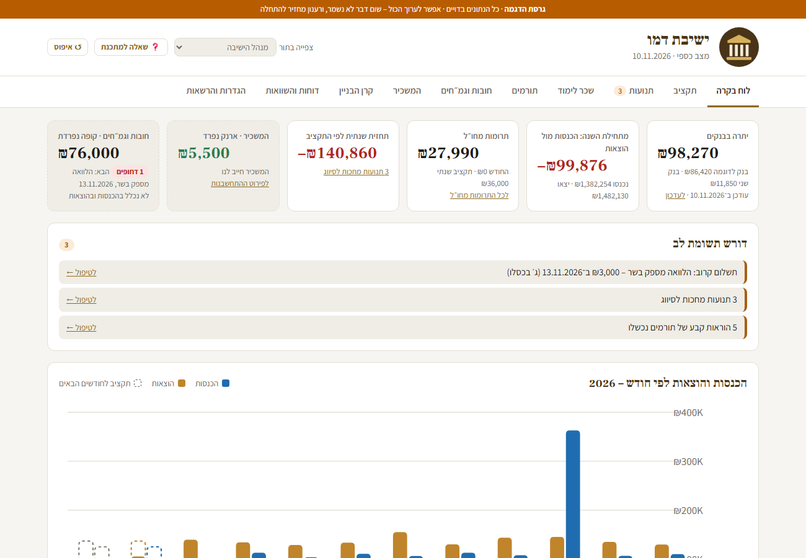
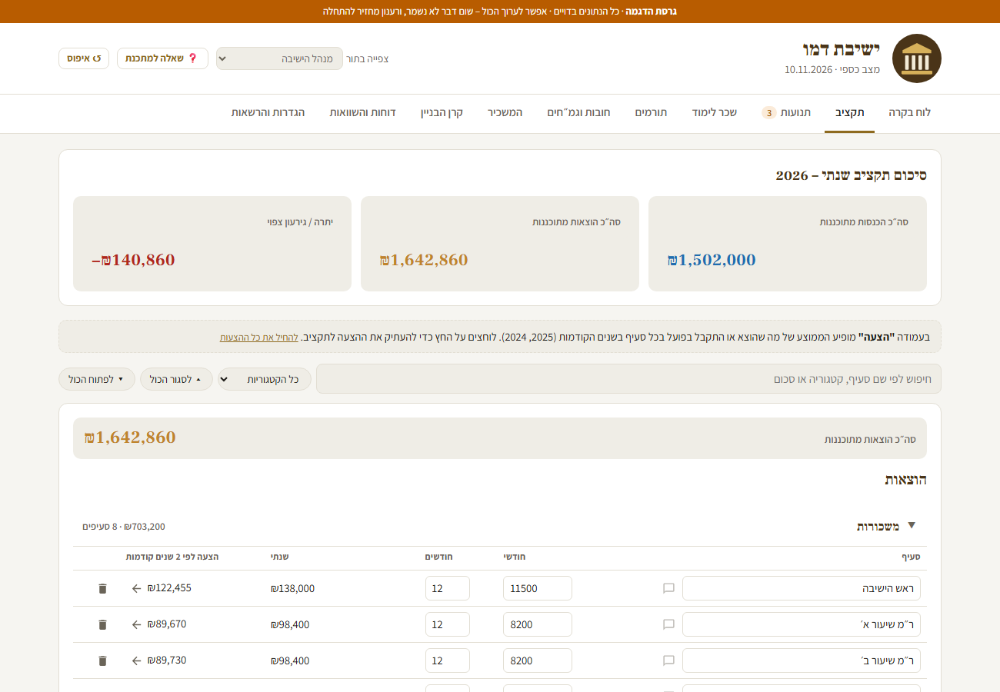
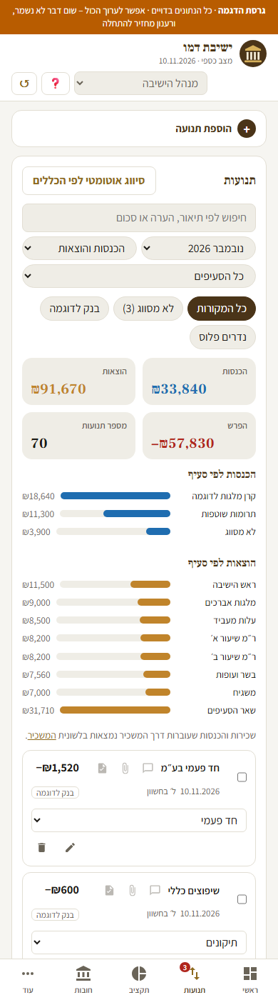

# מערכת ניהול כספים לישיבה

### 🔗 [לצפייה בדמו חי ←](https://yeshiva-finance-demo.web.app)
גרסת הדגמה עם נתונים בדויים. אפשר לערוך הכול, שום דבר לא נשמר.

מערכת לניהול כספי ישיבה: תקציב מול ביצוע, תנועות, שכר לימוד, תורמים, חובות וגמ"חים, קרן בניין, דוחות והשוואה רב־שנתית.
המערכת נבנתה עבור ישיבה פעילה ומשמשת את ההנהלה ואת רואה החשבון ביום־יום.
המאגר הזה הוא **גרסת ההדגמה**: אותם מסכים ואותה לוגיקה, עם נתונים בדויים ובלי שום פרט של הישיבה האמיתית.



| תקציב מול ביצוע | בטלפון |
|---|---|
|  |  |

## יכולות עיקריות
- **תקציב מול ביצוע:** סעיפים חודשיים ושנתיים. לכולל יש חישוב לפי מספר אברכים. ההצעה לתקציב מחושבת לפי ממוצע של השנים הקודמות.
- **סנכרון אוטומטי מנדרים פלוס** כל 3 שעות, דרך Cloud Function מתוזמנת:
  - תרומות, הוראות קבע ומס"ב.
  - סיווג אוטומטי לפי כללים.
  - שיוך תשלומי שכר לימוד לתלמידים.
- **תנועות:**
  - חיפוש וסינון לפי תקופה, מקור וסעיף.
  - עריכה ובחירה מרובה.
  - צירוף קבלות.
  - קישור תנועה לחוב, לתלמיד או לקרן.
- **קופות נפרדות:** גמ"חים וקרן בניין לא נספרים בהכנסות ובהוצאות. לבעל המבנה יש ארנק התחשבנות נפרד.
- **לוח בקרה:**
  - יתרות בבנקים.
  - תחזית שנתית ותחזית תזרים.
  - התראות על תשלומים קרובים, תנועות לא מסווגות והוראות קבע שנכשלו.
- **דוחות:**
  - לכל טווח תאריכים, עם הדפסה ו־CSV לרואה החשבון.
  - השוואה בין שנים, עם ממוצע.
- **הרשאות לפי תפקיד:** ראש ישיבה, מנהל, מזכיר ומתכנת עם עריכה מלאה. רואה חשבון בצפייה בלבד. האכיפה נעשית ב־Firestore Security Rules.
- **יומן שינויים:** כל פעולה נרשמת עם שם המשתמש.
- **"שאלה למתכנת":** נשלחת מתוך האפליקציה, עם צילום מסך והקלטת מסך.
- **PWA:**
  - מותקנת בטלפון ובמחשב ועובדת גם בלי חיבור.
  - ממשק RTL מלא ומותאם לנייד.

## טכנולוגיות
| | |
|---|---|
| Frontend | JavaScript (Vanilla), Vite, CSS – RTL, רספונסיבי, מצב כהה |
| Backend | Firebase Cloud Functions v2 (Node.js), Cloud Scheduler |
| נתונים | Cloud Firestore עם מטמון מקומי (offline), Cloud Storage |
| אבטחה | Firebase Auth עם אימות מייל, Security Rules לפי תפקיד, Secret Manager למפתחות |
| אינטגרציה | Nedarim Plus API |

## מבנה
```
src/app.js          מסכים ולוגיקה
src/demo.js         נתונים בדויים ושכבת שמירה בזיכרון (במערכת האמיתית: Firestore)
src/style.css       עיצוב – RTL, רספונסיבי, מצב כהה
functions/index.js  השרת: סנכרון נדרים פלוס מתוזמן ושליחת מיילים
firestore.rules     הרשאות לפי תפקיד
```

## הרצה
```
npm install
npm run dev      # פיתוח מקומי
npm run build    # בנייה ל-dist
```

---
פיתוח: **תמר יעקבי** · `tamar.build()`
